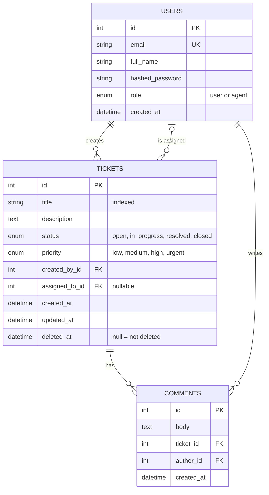

# Mini Helpdesk

A small fullstack ticketing system built for the Symphony individual internship evaluation.

Users submit tickets (title, description, priority) and comment on them. Agents see all tickets, change their status and priority, assign tickets to themselves, and comment. Regular users see only their own tickets.

| Part | Stack |
|---|---|
| Backend (`backend-api/`) | Python 3.13, FastAPI, SQLAlchemy 2, SQLite, Pydantic, bcrypt, PyJWT, pytest |
| Frontend (`frontend-app/`) | React, Vite, React Router, Context API, plain CSS |

---

## Features

- Register and log in with JWT authentication (passwords hashed with bcrypt)
- Two roles: `user` and `agent`
- Tickets: create, view, edit, soft delete
- Agents: change status and priority, assign a ticket to themselves
- Comments on tickets
- Ticket list with filters (status, priority, assigned agent), search by title and pagination
- Role-aware UI (agents see all tickets and agent actions; users see their own tickets)
- Centralized validation and error handling (consistent `{"detail": ...}` error format)
- Automated backend tests (pytest)
- Responsive layout (the ticket table turns into cards on phones)

---

## Getting started

Requirements: **Python 3.13** and **Node.js 20+**.

### 1. Backend

```bash
cd backend-api
python -m venv .venv
.venv\Scripts\activate          # Windows (PowerShell: .venv\Scripts\Activate.ps1)
# source .venv/bin/activate     # macOS / Linux
pip install -r requirements.txt
```

Create the environment file and set a secret:

```bash
cp .env.example .env            # Windows: copy .env.example .env
python -c "import secrets; print(secrets.token_hex(32))"
```

Paste the generated value into `.env` as `JWT_SECRET=...`.

Create the demo accounts and start the API:

```bash
python -m app.seed
uvicorn app.main:app --reload
```

- API: http://127.0.0.1:8000
- Interactive API docs (Swagger): http://127.0.0.1:8000/docs

The SQLite database (`helpdesk.db`) and its tables are created automatically on startup.

### 2. Frontend

In a second terminal:

```bash
cd frontend-app
npm install
cp .env.example .env            # Windows: copy .env.example .env
npm run dev
```

Open http://localhost:5173.

### 3. Demo accounts

Created by `python -m app.seed` (safe to run more than once):

| Email | Password | Role |
|---|---|---|
| agent1@example.com | Agent123! | agent |
| agent2@example.com | Agent123! | agent |
| user@example.com | User1234! | user |

New accounts created through registration are always regular users.

### 4. Tests

```bash
cd backend-api
pytest -v
```

The tests use a separate in-memory database, so they never touch `helpdesk.db`.

---

## Architecture

### Backend

```
backend-api/app/
  main.py        app setup: CORS, error handlers, routers, table creation on startup
  db.py          engine, session factory, get_db (one session per request)
  deps.py        dependencies: DbSession, CurrentUser, AgentUser
  seed.py        demo accounts
  core/          standalone tools: config (.env), security (bcrypt, JWT), exceptions
  models/        SQLAlchemy models: User, Ticket, Comment, enums
  schemas/       Pydantic request/response schemas (DTOs)
  services/      business logic and permission rules
  routers/       HTTP endpoints only
```

A request flows **router → service → models/database**. Routers only handle HTTP (URL, status code, schemas) and call a service. Services contain the business rules and raise custom exceptions (`NotFoundError`, `ForbiddenError`, ...). One central handler in `main.py` turns those exceptions into JSON responses. `deps.py` provides the database session and the current user to the endpoints.

### Frontend

```
frontend-app/src/
  App.jsx        routes (public: login/register; protected: everything else)
  api/           client.js (the only place that calls fetch) + one module per resource
  context/       AuthContext: logged-in user, login, register, logout
  components/    Layout, ProtectedRoute, FormField, TicketForm, TicketFilters, Pagination, ...
  pages/         one component per screen
  utils/         formatting helpers
```

All requests go through `api/client.js`, which adds the JWT, converts JSON, and turns every error into one `ApiError` type (including per-field errors from validation). The logged-in user is global state (Context API); everything else is local state in the page that uses it.

### Data model



A ticket has exactly one creator and zero or one assignee, so `tickets` has two foreign keys to `users`.

---

## API

All endpoints except register and login require `Authorization: Bearer <token>`.

| Method | Endpoint | Description | Who |
|---|---|---|---|
| POST | `/api/auth/register` | Create an account (always role `user`) | anyone |
| POST | `/api/auth/login` | Get a JWT | anyone |
| GET | `/api/auth/me` | Current user | logged in |
| GET | `/api/tickets` | List with `status`, `priority`, `assigned_to_id`, `search`, `page`, `page_size` | users: own · agents: all |
| POST | `/api/tickets` | Create a ticket | logged in |
| GET | `/api/tickets/{id}` | Ticket details | users: own · agents: all |
| PATCH | `/api/tickets/{id}` | Update fields | see rules below |
| POST | `/api/tickets/{id}/assign` | Assign the ticket to yourself | agents |
| DELETE | `/api/tickets/{id}` | Soft delete | owner while open · agents |
| GET | `/api/tickets/{id}/comments` | List comments | anyone who can see the ticket |
| POST | `/api/tickets/{id}/comments` | Add a comment | anyone who can see the ticket (not when closed) |

**Permission rules**

| Action | Regular user | Agent |
|---|---|---|
| See tickets | own only | all |
| Edit title / description | own, while `open` | yes |
| Change status / priority | no | yes |
| Assign to self | no | yes |
| Delete | own, while `open` | yes |

Status codes used: 200, 201, 204, 400, 401, 403, 404, 409, 422, 500.

---

## Key decisions

**Backend**
- **Layered structure** (routers → services → models) so HTTP handling, business rules and data access stay separate.
- **Centralized error handling:** services raise custom exceptions; one handler turns them into `{"detail": "..."}`. A catch-all handler returns the same shape for unexpected errors without leaking details.
- **Visibility rules in one base query:** every ticket query starts from a function that excludes soft-deleted tickets and, for regular users, other people's tickets, so no endpoint can forget the rule.
- **404 instead of 403** for someone else's ticket, so its existence isn't revealed. Login returns the same message for an unknown email and a wrong password.
- **Roles:** registration has no `role` field, so users can't make themselves agents; agents come from the seed script. The current user is loaded from the database on every request, so role changes apply immediately.
- **Soft delete** with a nullable `deleted_at` (records when, keeps history).
- **SQLite** for zero setup. SQLite doesn't enforce foreign keys by default, so they are enabled on every connection; enum columns have CHECK constraints.
- **N+1 queries avoided** with `selectinload` for ticket creators/assignees and comment authors.
- **`create_all` instead of migrations** to keep the scope small (Alembic would be the next step).
- **bcrypt's 72-byte limit** is validated in the schema, so long passwords return 422 instead of 500.

**Frontend**
- **One request function** for all API calls (token, JSON, error parsing), so every page handles loading and errors the same way.
- **Filters and page number in the URL**, so reload, the Back button and shared links keep them.
- **Late responses are ignored** when filters or tickets change quickly.
- **The UI mirrors the backend rules** (hides actions that would fail), but the backend enforces everything.
- **Token in localStorage:** simple and survives reloads; the trade-off is exposure to XSS (an httpOnly cookie would be safer).
- **UTC times:** the API returns UTC without a timezone marker, so the frontend adds `Z` before converting to local time.

---

## Possible improvements

- Alembic migrations and PostgreSQL for production
- Refresh tokens / token revocation and rate limiting on login
- Return 409 on a registration race (catch the unique-constraint error)
- More tests (comments, filters, pagination) and frontend tests
- Docker Compose for one-command setup

---

## Use of AI

AI tools (Claude) were used to generate code, explain concepts and review decisions. Every Pull Request describes where AI helped and what was checked or changed manually. Several issues were found during manual testing and fixed, for example: users getting 403 when re-sending an unchanged status, a stale `assigned_to` value after assigning, missing database CHECK constraints for enums, and a misleading message on closed tickets.
